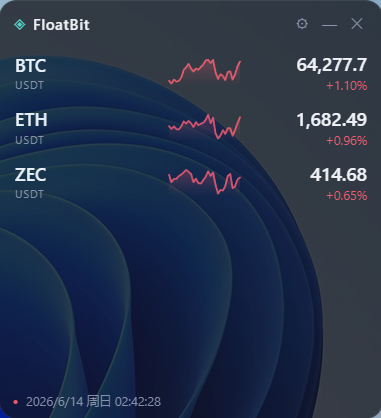
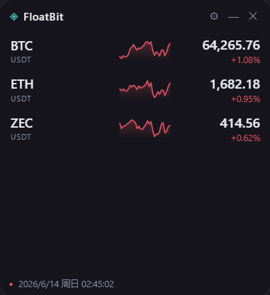
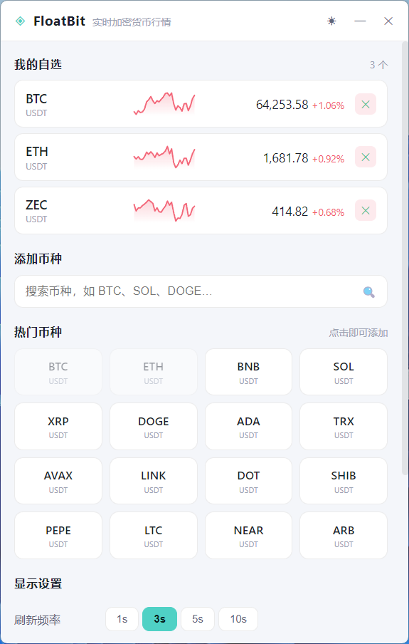

<p align="center">
  
</p>

<h1 align="center">FloatBit</h1>

<p align="center">实时加密货币行情悬浮窗 · 盯盘，不挡视线</p>

<p align="center">
  <a href="https://nagnip-xu.github.io/FloatBit/">访问官网</a> ·
  <a href="https://nagnip-xu.github.io/FloatBit/#download">下载安装</a> ·
  <a href="https://github.com/Nagnip-xu/FloatBit/issues">反馈问题</a>
</p>

FloatBit 是一款面向 **Windows 和 Android** 的轻量行情工具。把 BTC、ETH、SOL 等自选币种放在屏幕一角，查看实时价格、涨跌和走势，同时继续工作或使用其他应用。

行情来自币安公共接口，**无需账户登录或 API 密钥**。项目包含 Electron 桌面端、Kotlin 原生安卓端，以及通过 GitHub Pages 发布的中文官网。

## 界面预览

以下为项目中的真实桌面端截图，图中行情为截图时的数据。

<table>
  <tr>
    <th>半透明悬浮窗</th>
    <th>暗色悬浮窗</th>
  </tr>
  <tr>
    <td></td>
    <td></td>
  </tr>
</table>

<details open>
  <summary><strong>主面板：自选管理、搜索、热门币种与显示设置</strong></summary>
  <p></p>
</details>

## 功能

| 功能 | Windows 桌面端 | Android 手机端 |
| --- | --- | --- |
| 实时行情 | WebSocket 推送，断线自动重连 | WebSocket 推送，断线自动重连 |
| 自选管理 | 搜索交易对、热门币种一键添加、移除自选 | 搜索、热门币种、移除与长按拖动排序 |
| 悬浮显示 | 无边框置顶窗口，可拖动并记忆位置 | 显示在其他应用上层，可拖动 |
| 收起与展开 | 桌面迷你悬浮球、系统托盘 | 单币模式、边缘半隐胶囊 |
| 外观设置 | 明暗主题、透明度、涨跌配色 | 明暗主题、透明度、涨跌配色 |
| 走势预览 | 每个币种的迷你走势图 | 每个币种的迷你走势图 |

支持切换「绿涨红跌 / 红涨绿跌」。自选和显示偏好保存在本地。

## 下载与安装

直接访问 [官网](https://nagnip-xu.github.io/FloatBit/) 即可查看介绍和下载安装包。

| 平台 | 安装包 | 当前版本 | 大小与要求 |
| --- | --- | --- | --- |
| Windows | [下载 EXE 安装程序](https://nagnip-xu.github.io/FloatBit/FloatBit-Setup-1.0.0.exe) | 1.0.0 | 约 74.84 MiB；Windows 10 / 11，x64 |
| Android | [下载 APK](https://nagnip-xu.github.io/FloatBit/FloatBit-Android.apk) | 1.0（versionCode 1） | 约 6.10 MiB；Android 7.0 / API 24 及以上 |

Android 当前提供的是项目已有的 **debug 构建**。桌面与手机端版本号分别维护。仓库内的 `website/` 同时保存这两个官网分发文件；文件校验值见 [SHA256SUMS.txt](website/SHA256SUMS.txt)。

**Windows 使用：**

1. 下载并运行 EXE，按向导选择安装位置。
2. 打开主面板，搜索币种或从热门列表添加自选。
3. 将悬浮窗拖到合适位置，在设置中调整主题、透明度和涨跌配色。
4. 点击「—」收为悬浮球；关闭窗口可隐藏到托盘，右键托盘图标可退出。

**Android 使用：**

1. 下载 APK，并在系统设置中允许下载来源安装应用。
2. 安装后打开 FloatBit，添加自选币种。
3. 点击「开启悬浮窗」，按提示授予「显示在其他应用上层」权限，再返回应用开启。
4. 按需授予通知权限；悬浮窗可以拖动、缩小并收起。

目前没有提供 iOS、macOS 或 Linux 安装包。

## 项目结构

```text
FloatBit/
├── desktop/                 # Windows 桌面端（Electron）
│   ├── src/                 # 主进程、预加载桥接、悬浮窗与主面板
│   ├── assets/              # 应用与托盘图标
│   ├── build/make_icon.py   # 图标生成脚本，不是构建缓存
│   └── package.json
├── FloatBit_Android/        # 原生 Android 项目（Kotlin + XML）
│   ├── app/src/main/        # Activity、悬浮窗服务、网络与资源
│   └── gradle/              # Gradle Wrapper 与依赖版本目录
├── website/                 # 官网静态文件、真实截图与下载文件
├── shared/                  # 独立的行情 REST 与格式化工具
├── mobile/README.md         # 手机端项目入口说明
├── docs/                    # 数据接口与官网部署文档
└── .github/workflows/       # GitHub Pages 自动部署
```

`shared/binance.js` 是独立工具模块，当前桌面端与原生安卓端各自实现网络接入。

## 本地开发

先克隆仓库：

```bash
git clone https://github.com/Nagnip-xu/FloatBit.git
cd FloatBit
```

### Windows 桌面端

准备 Node.js 20 或更新的 LTS 版本，以及 npm。

```bash
cd desktop
npm ci
npm start
```

生成 Windows 安装程序：

```bash
npm run dist
```

使用 Electron 31、原生 HTML / CSS / JavaScript、`ws` 和 electron-builder。打包目标为 Windows x64 NSIS，输出位于 `desktop/dist/`。更多说明见 [桌面端 README](desktop/README.md)。

### Android 手机端

用支持项目 Android Gradle Plugin 的 Android Studio 打开 `FloatBit_Android/`，使用 **JDK 17**，安装 **Android SDK Platform 36**，等待 Gradle 同步后运行到手机或模拟器。

在 Windows PowerShell 中也可以构建 debug APK：

```powershell
cd FloatBit_Android
.\gradlew.bat assembleDebug
```

输出位于 `FloatBit_Android/app/build/outputs/apk/debug/`。命令行构建前需在 `local.properties` 配置自己的 `sdk.dir`，或设置 `ANDROID_HOME`。本机 SDK 路径不会提交到仓库。

技术栈为 Kotlin 2.0、XML 布局、OkHttp、RecyclerView 和 Material Components。`compileSdk` / `targetSdk` 为 36，`minSdk` 为 24。更多说明见 [安卓端 README](FloatBit_Android/README.md)。

### 官网预览

官网是纯静态站点，不需要安装前端构建依赖。在仓库根目录执行：

```bash
python -m http.server 8000 --directory website
```

然后访问 `http://localhost:8000`。官网预览行情通过浏览器请求币安 REST 接口，联网情况会影响行情显示。

## GitHub Pages 官网

官网地址：**https://nagnip-xu.github.io/FloatBit/**

仓库使用 [GitHub Actions 工作流](.github/workflows/deploy-pages.yml) 发布 `website/`。向 `main` 分支推送官网文件或部署工作流的修改后，会自动更新网站；也可以在 Actions 页面手动运行「部署 FloatBit 官网」。

首次配置与排查步骤见 [官网部署说明](docs/deployment.md)。以后只修改根目录 README，不会触发无关的网站部署。

## 数据来源与常见问题

- **数据来自哪里？** 价格主要来自币安公共 WebSocket；K 线、交易对等通过 REST 获取。接口说明见 [币安行情接口文档](docs/binance-api.md)。官网演示采用 REST 定时刷新。
- **为什么看不到行情？** 请确认网络可以访问 `data-api.binance.vision` 和 `data-stream.binance.vision`；受网络、接口限制或服务状态影响时，行情可能暂时不可用。
- **安卓悬浮窗没有出现？** 确认已开启「显示在其他应用上层」权限；后台运行还可能受手机系统省电设置影响。
- **为什么克隆后没有依赖或构建目录？** `node_modules/`、Gradle 缓存和编译输出由 `.gitignore` 排除，按上面的步骤重新安装或构建即可。
- **需要账户或交易密钥吗？** 不需要。本项目展示公共行情，不提供下单、交易或资产托管功能。

价格数据仅供参考，不构成投资建议。欢迎通过 [Issues](https://github.com/Nagnip-xu/FloatBit/issues) 反馈问题，附上平台、版本、复现步骤与相关截图。

作者：[Nagnip-xu](https://github.com/Nagnip-xu)
